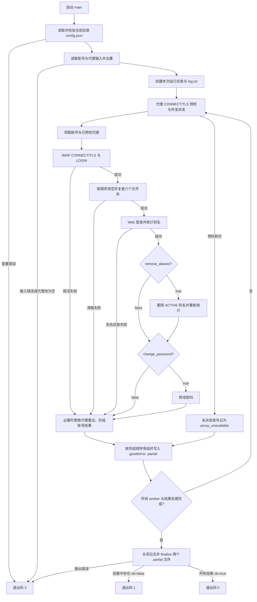

# 架构、执行流程与错误处理

本文描述当前实现；行为变更以代码为准，安全规则以 [`AGENTS.md`](../AGENTS.md) 为准。入口没有 CLI 参数，`main()` 从当前工作目录加载配置。

## 模块职责

| 文件 | 职责 |
|---|---|
| [`check_and_clean_accounts.py`](../check_and_clean_accounts.py) | 配置和输入解析、代理预检与并发派发、每账号编排、输出筛选/写盘、退出码 |
| [`imap_fallback.py`](../imap_fallback.py) | HTTP(S) 代理隧道、IMAP/POP3 连接封装、IMAP 文件夹清理和只读读取客户端 |
| [`mailcom_client.py`](../mailcom_client.py) | mail.com Web/OAuth 客户端、别名查询/删除、密码修改 |
| [`config.example.json`](../config.example.json) | 唯一公开配置模板；真实配置文件不应进入仓库 |

账号检查主流程使用可写的 IMAP 清理客户端；模块内存在只读客户端不代表入口提供只读模式。

## 端到端流程

图展示主要阶段；并发 worker 可交错执行，不代表严格串行的全局时序。每个账号的阶段顺序是 IMAP 探活 → 清空并复查 `Drafts`、`INBOX`、`OUTBOX`、`Sent`、`Spam`、`Trash`（`Trash` 最后）→ Web 登录和别名检查；别名删除、密码修改仅在对应配置开关为 `true` 时执行。

## 阶段与错误处理

| 阶段 | 当前处理与错误结果 | 运行影响 |
|---|---|---|
| 配置 | 配置文件读取失败为 `config_file_error`；JSON 或字段校验失败为 `config_error` | 在账号处理前停止，退出码 `2` |
| 账号/代理输入 | 读取失败为 `input_file_error`；格式错误可为 `account_format`、`proxy_format`，空代理池为 `proxy_file_empty`，其他输入校验错误为 `input_error` | 在账号处理前停止，退出码 `2` |
| 代理预检/派发 | 先验证代理到 IMAP 的 CONNECT/TLS 传输，不在预检中发送账号 `LOGIN`。代理候选失败后不再使用；候选耗尽时停止新派发，在途账号继续收尾，未派发账号得到 `proxy_unavailable` | 账号级失败会进入错误结果；可能使最终退出码为 `1` |
| IMAP 探活 | 开始清箱前的连接、登录或 IMAP 探活失败可在最多 `MAX_ATTEMPTS` 次尝试内更换预检代理；`proxy_required` 表示代理地址缺失，保留为非重试配置错误；代理连接/TLS/超时等传输故障映射为 `proxy_error` 并可尝试其他已预检代理 | 尝试耗尽或无新代理时形成账号失败 |
| IMAP 清箱 | 任一文件夹操作失败或复查未清空时记为 `imap_clear_failed`；清箱已开始后不重放账号流程，避免重复执行不可安全重放的删除操作 | 该账号失败；后续 Web 阶段不执行 |
| Web 登录/别名读取 | 最多 `MAX_ATTEMPTS` 次尝试，失败时可更换预检代理；错误映射包括 `bad_credentials`、`login_challenged`、`rate_limited`、`proxy_error`、`network_error`、`alias_error` | 重试耗尽或代理耗尽后形成账号失败 |
| 删除 ACTIVE 别名 | 只在 `remove_aliases: true` 时执行；单个删除失败会记录失败并继续处理其他别名，随后重新读取别名状态。是否满足最终输出筛选条件，以复查数量为准 | 不能把单次删除失败直接等同于整体 Web 阶段失败；详见下方结果筛选 |
| 改密码 | 只在 `change_password: true` 时执行；新密码生成一次并在允许的连接类重试中复用。仅代理/网络类错误可重试；明确的应用错误不重试 | 失败会让账号结果成为部分失败并写入错误结果；生成的新密码写入必要输出 |
| 输出目录/文件 | 输出路径冲突或目录、文件写入/改名失败时报告输出错误（如 `output_path_conflict`、`output_file_error`） | 运行级错误，退出码 `2`；中断或失败可能留下 `.partial` 文件 |

`MAX_ATTEMPTS` 当前为 `3`。这不是所有网络操作共用的一条统一重试循环：清箱阶段不重试，密码修改只对连接/网络类错误重试；代理替换还要求存在未领取且通过预检的候选代理。

## 错误处理与结果判定

每次运行在 `output_dir/<YYYYmmdd_HHMMSS_mmm>/` 新建目录，写出 `good_accounts.txt`、`error_accounts.txt`、`log.txt`。账号结果文件逐条流式写入，按完成顺序而非输入顺序排列；前两个文件先写为 `.partial`，全部结果正常完成后再改为最终文件名。`log.txt` 不走该改名流程。异常中断时 `.partial` 可能包含明文密码，应按敏感输出处理并人工清理。

当前主程序始终按别名条件筛选输出：

- `good_accounts.txt` 要求六个目标文件夹的复查数量均为 `0`、IMAP 状态为 `ready`、别名检查成功、ACTIVE 别名数为 `0`，且非 ACTIVE 别名数不超过 `MAX_INACTIVE_ALIASES`（当前为 `90`）。格式为 `email----password`。
- 未满足上述条件的账号写入 `error_accounts.txt`，格式为 `email----password----error_kind`。
- 密码变更成功时，新密码替代原密码写入结果文件。两个账号结果文件及日志都属于敏感输出，日志可能包含改密前后的凭据。

**错误文件分类与进程退出码不是同一个判定。** 文件分类使用上述筛选条件；最终退出码则根据编排结果中的 `ok` 标志计算：所有结果 `ok=true` 返回 `0`，存在 `ok=false` 返回 `1`。因此某个结果可能因别名筛选条件被写入 `error_accounts.txt`，但其 `ok` 仍为 `true`，进程仍返回 `0`。配置、输入或输出运行级错误返回 `2`。

## 安全与验证边界

主入口会对真实账号执行 IMAP 清箱，不可作为“只测登录”的探活工具。`remove_aliases` 和 `change_password` 是额外的破坏性开关。没有符合 [`AGENTS.md`](../AGENTS.md) 的当前会话明确授权，不要执行主脚本、真实账号客户端、网络探测或读取私有输入/输出文件。默认本地验证仅限 `AGENTS.md` 所列编译、导入与离线替身方式；不要用真实账号或真实代理代替离线验证。
